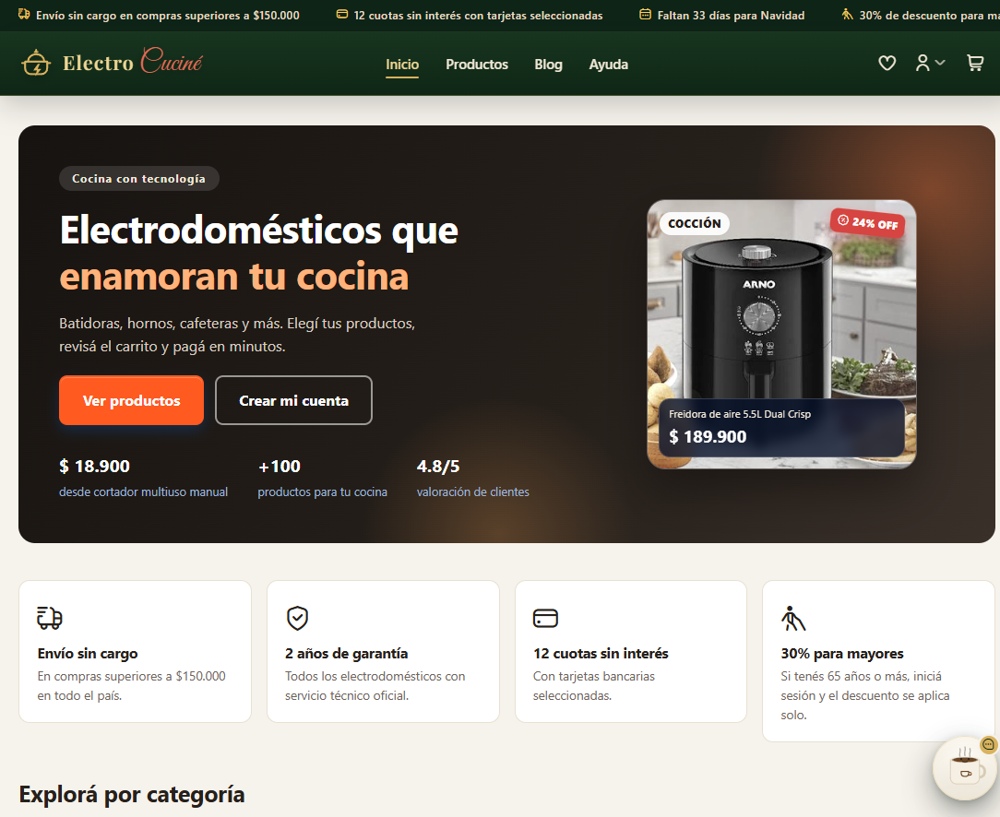

# Capturas de pantalla

Este set cubre el recorrido completo de la tienda en **7 imágenes**. Todas se tomaron del build local
servido por el backend (`npm run build` + `npm start`, `http://localhost:3001`), a **1440 px de ancho**,
en formato **PNG** y sin `fullPage` (se captura el viewport, igual que lo que ve el usuario al abrir la página).

| Archivo | Qué demuestra | Cómo regenerarla |
| --- | --- | --- |
| [`01-home.png`](capturas/01-home.png) | Home: hero, categorías, beneficios (envío gratis, garantía, cuotas, 30% para mayores) y productos destacados. | `http://localhost:3001/` → esperar a que carguen las cards → capturar. |
| [`02-catalogo.png`](capturas/02-catalogo.png) | Catálogo: filtros por categoría, orden, buscador y grilla de productos con precio/oferta. | `http://localhost:3001/productos` → capturar con la grilla visible. |
| [`03-producto.png`](capturas/03-producto.png) | Detalle de producto: foto, precio, cuotas, stock, favoritos y botones **Comprar ahora** / **Agregar al carrito**. | `http://localhost:3001/producto/1` → capturar sin abrir modales. |
| [`04-carrito.png`](capturas/04-carrito.png) | Carrito con un producto, aviso de envío gratis y resumen del pedido. | Desde el detalle, clic en **Agregar al carrito** → ir a `http://localhost:3001/carrito`. |
| [`05-chat-nero.png`](capturas/05-chat-nero.png) | Nero: chat abierto con saludo, sugerencias y respuesta con **3 freidoras reales** (foto, precio, stock y enlace al detalle). | Abrir el botón flotante de Nero → clic en *¿Qué freidoras tenés?* → esperar la respuesta → capturar. |
| [`06-cuenta.png`](capturas/06-cuenta.png) | Menú de cuenta con sesión iniciada: avatar, nombre de usuario, Mis compras, Favoritos, tema, modo navideño y cerrar sesión. | Ingresar con un usuario de prueba → clic en el ícono **Mi cuenta** del header → capturar con el menú desplegado. |
| [`07-mis-compras.png`](capturas/07-mis-compras.png) | Historial de pedidos: número de pedido, fecha, estado, ítems, total, botón *Repetir compra* y estimación de entrega. | Con sesión iniciada, ir a `http://localhost:3001/mis-compras` con al menos una venta registrada. |

> Las capturas `06` y `07` usan la cuenta local de prueba `pruebacarrito`. El pedido `#8` es una
> **venta de prueba creada en la base local** (`BackEnd/data/`, ignorada por git) solo para documentar
> el historial. No hay datos de clientes reales en ninguna imagen.

## Cómo insertarlas en Markdown

Desde el `README.md` (las imágenes están en `docs/capturas/`):

```markdown

```

Desde este mismo archivo (`docs/CAPTURAS.md`), la ruta es relativa a `docs/`:

```markdown

```

Con HTML podés controlar el tamaño, útil para galerías en tablas:

```html

```

### Reglas para que sirvan de documentación

- **Nombre predictor**: `NN-slug.png` (`01-home`, `02-catalogo`, …). El prefijo numérico fija el orden del recorrido.
- **Texto alternativo descriptivo**: no "captura 1", sino *"Carrito con una freidora y resumen del pedido"*. Es lo que lee un lector de pantalla y lo que se muestra si la imagen no carga.
- **Sin secretos ni datos personales**: nunca capturar `.env`, tokens, correos reales ni el panel admin con credenciales visibles.
- **Sin etiquetas de "demo"**: la tienda está pensada para parecerse a una real; la captura debe mostrar el estado normal.
- **Estado limpio**: cerrar modales y notificaciones que tapen contenido; dejar el carrito y la sesión en un estado reproducible.
- **Cambios de UI**: si cambia el diseño, regenerar solo las afectadas y mantener el mismo nombre de archivo para no romper los enlaces del README.

## Cómo tomarlas (herramienta de navegador)

Con la herramienta de navegador integrada, el flujo es:

1. Abrir la URL en el tab.
2. Esperar a que cargue (`condition: 'load'`) y, si hay datos async, esperar un texto concreto.
3. Capturar con `format: 'png'`, `maxWidth: 1440` y `fullPage: false`.
4. Copiar el archivo temporal a `docs/capturas/NN-slug.png` y agregarlo al git.

También se pueden tomar a mano: abrir `http://localhost:3001` en Chrome, usar
**Herramientas de desarrollador → Capturar pantalla** (Ctrl+Shift+P → "Capture full size screenshot"
solo si necesitás la página completa).
